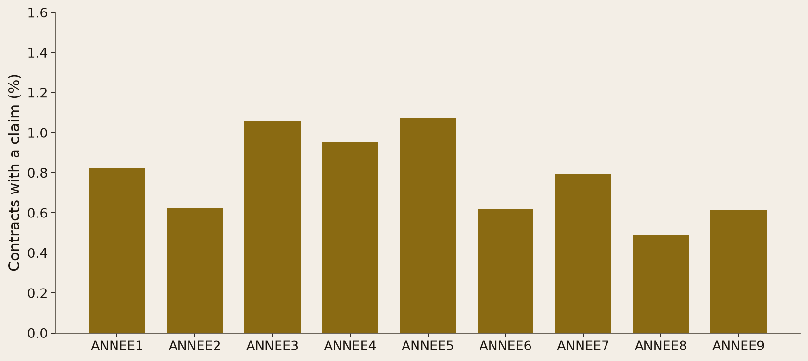
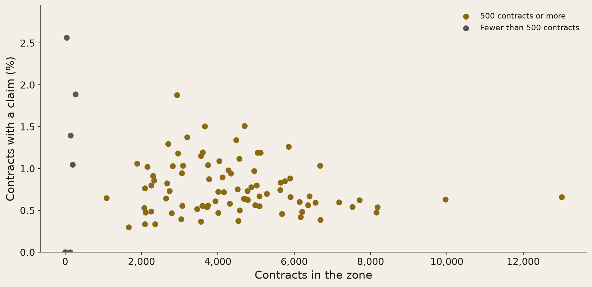

<!-- _class: cover -->
<!-- _paginate: false -->

# What is a fire worth
# when it almost
# never happens?

Machine learning · Agriculture

France · 9 anonymised exercise years

---

<!-- _class: split -->

# A fire stops
# the farm.

Fire is a large share of what the multi-risk policy pays out.

**Miss the premium, and both the insurer and the farmer plan on the wrong number.**

---

<!-- _class: split -->

# Pacifica sets
# the premium.

The farmer covers the business, the buildings, the equipment.

**The decision: what fire cost to expect on this contract, this year.**

---

<!-- _class: full -->

# Fire starts
# in the buildings.

Timber, stored feed, machinery. Work stops until they are rebuilt.

---

<!-- _class: split -->

# One row is one
# contract, one year.

383,610 contracts. Nine anonymised years, and no calendar.

**The cost on the row is zero almost everywhere. An average hides that.**

---

<!-- _class: full -->

# More than half
# the contracts cover
# only part of the year.

45% cover one full year. Almost none run past two.

---

<!-- _class: dark -->

# This project is not.

Not a prevention audit.

Not the commercial price, loadings and margin included.

**The pure premium: the fire cost one can expect.**

---

<!-- _class: full -->

# 99.25%
# of contracts
# have no fire claim.

---

<!-- _class: chart -->

## About one claim in a hundred contracts, or in two hundred.

It depends on the year label. Fire does not become common.

---

<!-- _class: chart -->

## Four contracts are not a region.

93 zones. Grey means fewer than 500 contracts: that rate is not a map of where fire starts.

---

<!-- _class: actions -->

# Monday.

**Pricing** — separate "will there be a fire?" from "if there is one, what does it cost?"

**Data** — a surface written twice is still one surface.

An expected cost, read from what we actually see.

---

<!-- _class: cta -->

# The detail is in the code.

[Source repository](https://github.com/dimiphoton/ML-zoom-camp-midterm-project)

A first estimate, on contracts kept aside, does no better than expecting no fire.
