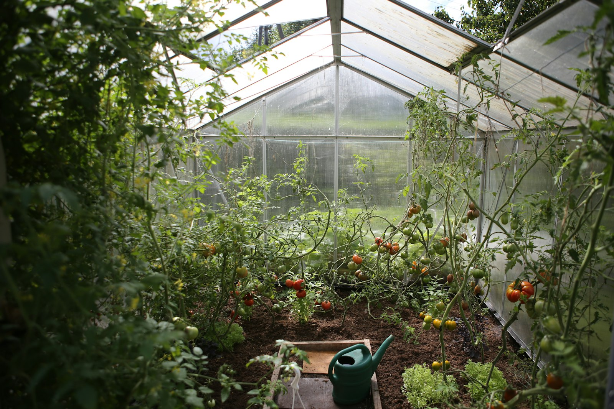
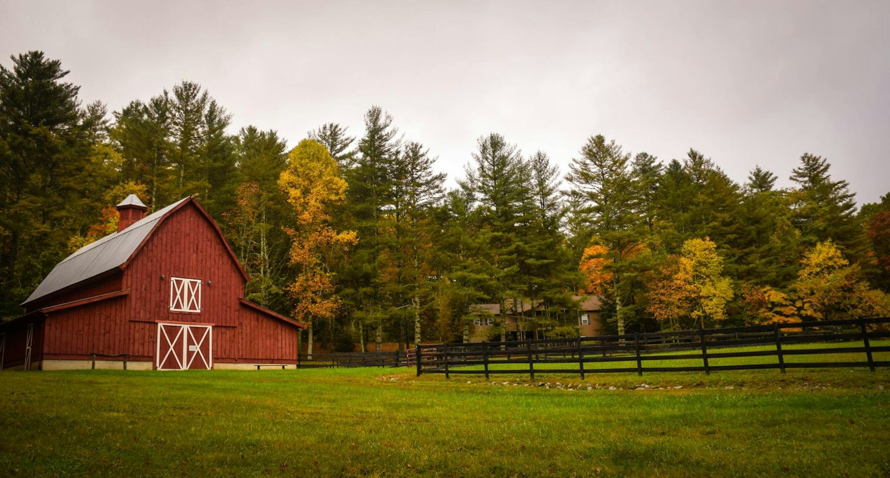
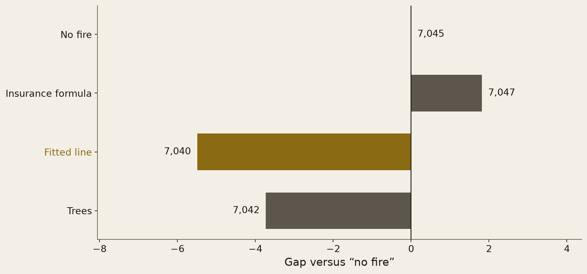

<!-- _class: cover -->
<!-- _paginate: false -->

# What is a fire worth
# when it almost
# never happens?

Machine learning · Agriculture

France · 9 anonymised exercise years

---

<!-- _class: split -->

# A fire stops
# the farm.

Fire is a large share of what the multi-risk policy pays out.

**Miss the premium, and both the insurer and the farmer plan on the wrong number.**

---

<!-- _class: split -->

# Pacifica sets
# the premium.

The farmer covers the business, the buildings, the equipment.

**The decision: what fire cost to expect on this contract, this year.**

---

<!-- _class: full -->

# Fire starts
# in the buildings.

Timber, stored feed, machinery. Work stops until they are rebuilt.

---

<!-- _class: split -->

# One row is one
# contract, one year.

383,610 contracts. Nine anonymised years, and no calendar.

**The cost on the row is zero almost everywhere. An average hides that.**

---

<!-- _class: full -->

# More than half
# the contracts cover
# only part of the year.

45% cover one full year. Almost none run past two.

---

<!-- _class: dark -->

# This project is not.

Not a prevention audit.

Not the commercial price, loadings and margin included.

**The pure premium: the fire cost one can expect.**

---

<!-- _class: full -->

# 99.25%
# of contracts
# have no fire claim.

---

<!-- _class: chart -->

## The fitted line misses by a little less than “no fire”.

Left of the line is closer. The gap stays thin: fire is rare.

---

<!-- _class: split -->

# This is not
# a selling price.

The line is the fire cost one can expect.

**The trees come close. The insurance formula still sits behind “no fire”.**

---

<!-- _class: actions -->

# Monday, one contract.

Describe the farm and how long the cover runs.

**The answer is the fire cost to expect.**

Start from the line. The gain is real, and small.

---

<!-- _class: cta -->

# It runs on your machine.

[Source repository](https://github.com/dimiphoton/ML-zoom-camp-midterm-project)

The instructions are in the repository.
