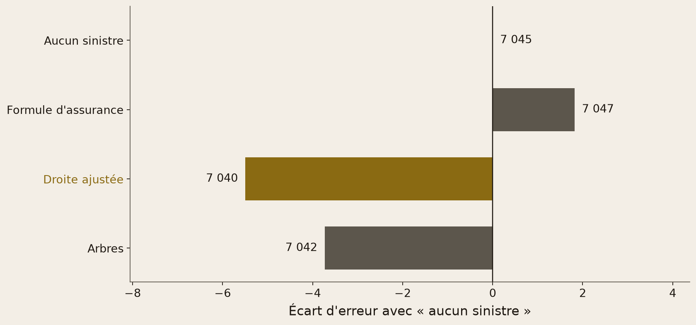

<!-- _class: cover -->
<!-- _paginate: false -->

# Combien vaut un incendie
# qui n'arrive presque
# jamais ?

Machine learning · Agriculture

France · 9 exercices anonymisés

---

<!-- _class: split -->

# Un feu arrête
# l'exploitation.

L'incendie pèse lourd dans ce que coûte le multirisque agricole.

**Une prime à côté, et l'assureur comme l'exploitant se trompent de chiffre.**

---

<!-- _class: split -->

# Pacifica fixe
# la prime.

L'agriculteur couvre l'activité, les bâtiments, le matériel.

**La décision : quel coût d'incendie attendre sur ce contrat, cette année.**

---

<!-- _class: full -->

# Le feu prend
# dans le bâti.

Bois, fourrage, matériel stocké. L'activité s'arrête le temps de reconstruire.

---

<!-- _class: split -->

# Une ligne,
# un contrat, un an.

383 610 contrats. Neuf millésimes anonymes, sans calendrier.

**Le coût affiché est nul presque partout. Une moyenne le cache.**

---

<!-- _class: full -->

# Plus d'un contrat
# sur deux ne couvre
# qu'une partie de l'année.

45 % couvrent un an pile. Presque aucun ne va au-delà de deux ans.

---

<!-- _class: dark -->

# Ce projet, ce n'est pas.

Pas un audit de prévention.

Pas le prix commercial, charges et marge comprises.

**La prime pure : le coût d'incendie que l'on peut attendre.**

---

<!-- _class: full -->

# 99,25 %
# des contrats
# n'ont aucun sinistre.

---

<!-- _class: chart -->

## La droite se trompe un peu moins que « pas d'incendie ».

À gauche du trait, c'est plus juste. L'écart reste mince : le feu est rare.

---

<!-- _class: split -->

# Ce n'est pas
# un prix de vente.

La droite donne le coût d'incendie que l'on peut attendre.

**Les arbres s'en approchent. La formule d'assurance reste derrière « aucun sinistre ».**

---

<!-- _class: actions -->

# Lundi.

**Tarification** — partir de la droite, pas de l'arbre le plus chargé.

**Lecture** — le gain est réel, et petit.

Un coût attendu, lu sur des contrats mis de côté.

---

<!-- _class: cta -->

# Le détail est dans le code.

[Dépôt GitHub](https://github.com/dimiphoton/ML-zoom-camp-midterm-project)

On retient la droite. « Aucun sinistre » reste le chiffre à battre.
