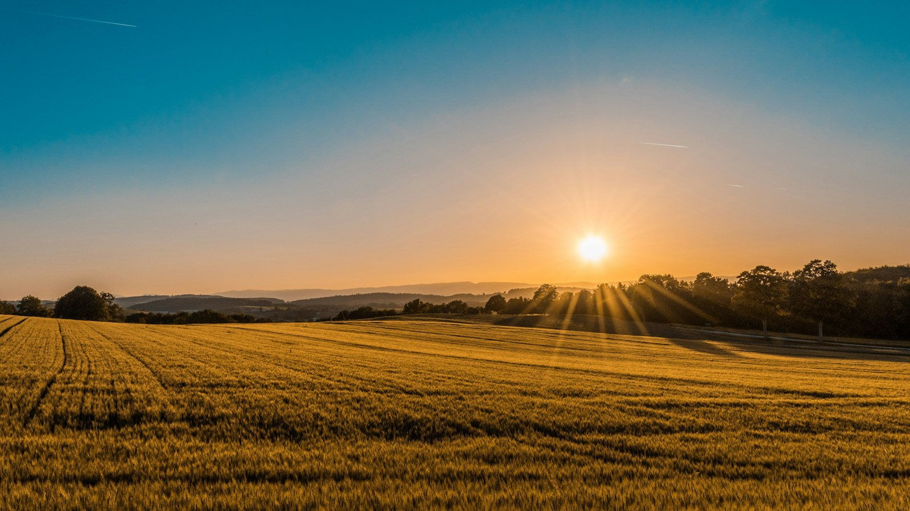
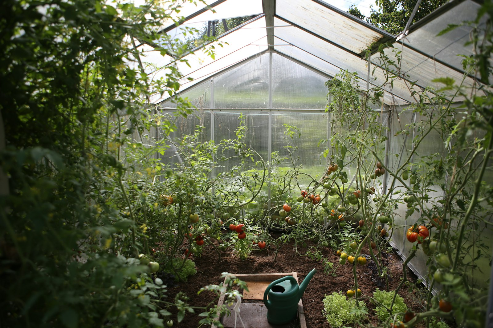
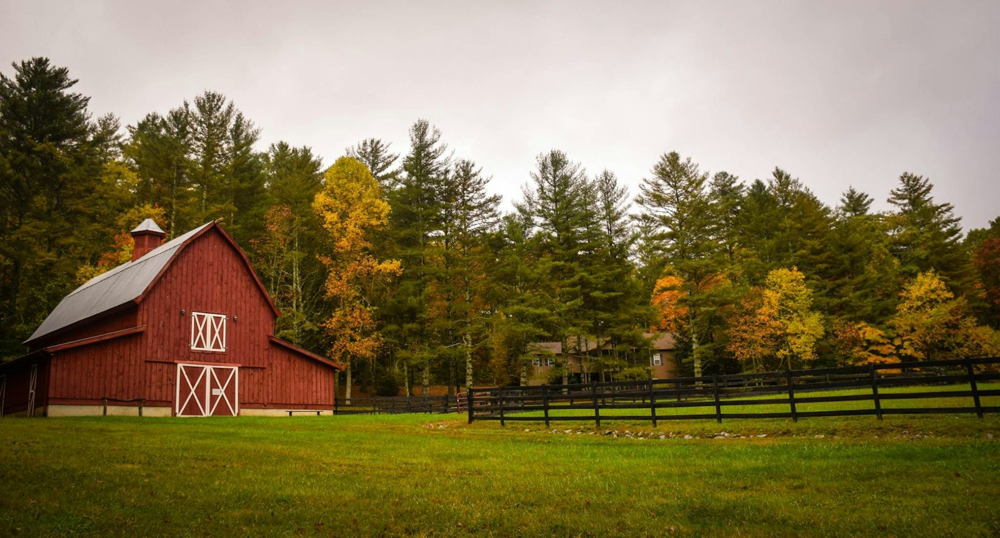
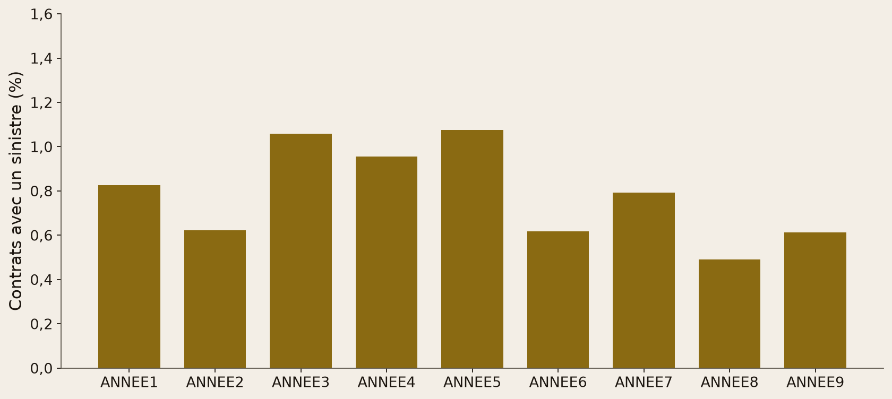
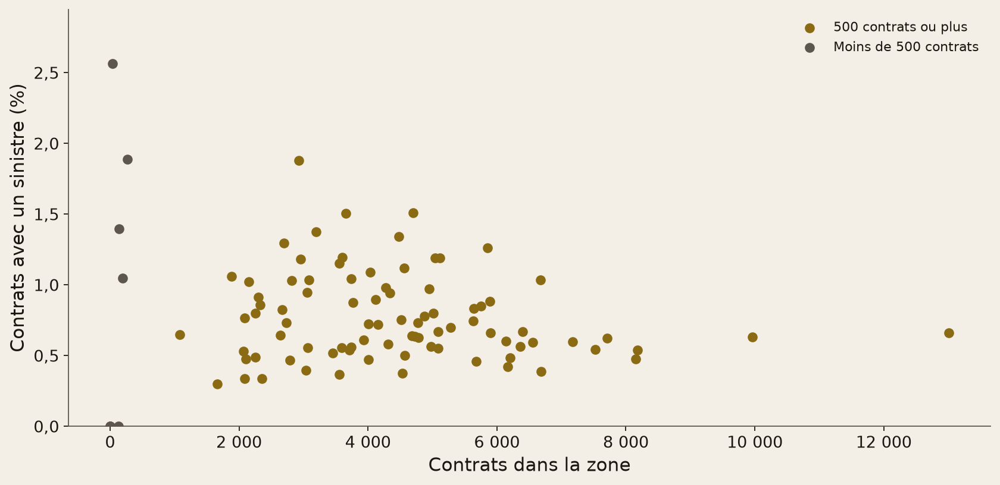

<!-- _class: cover -->
<!-- _paginate: false -->

# Combien vaut un incendie
# qui n'arrive presque
# jamais ?

Machine learning · Agriculture

France · 9 exercices anonymisés

---

<!-- _class: split -->

# Un feu arrête
# l'exploitation.

L'incendie pèse lourd dans ce que coûte le multirisque agricole.

**Une prime à côté, et l'assureur comme l'exploitant se trompent de chiffre.**

---

<!-- _class: split -->

# Pacifica fixe
# la prime.

L'agriculteur couvre l'activité, les bâtiments, le matériel.

**La décision : quel coût d'incendie attendre sur ce contrat, cette année.**

---

<!-- _class: full -->

# Le feu prend
# dans le bâti.

Bois, fourrage, matériel stocké. L'activité s'arrête le temps de reconstruire.

---

<!-- _class: split -->

# Une ligne,
# un contrat, un an.

383 610 contrats. Neuf millésimes anonymes, sans calendrier.

**Le coût affiché est nul presque partout. Une moyenne le cache.**

---

<!-- _class: full -->

# Plus d'un contrat
# sur deux ne couvre
# qu'une partie de l'année.

45 % couvrent un an pile. Presque aucun ne va au-delà de deux ans.

---

<!-- _class: dark -->

# Ce projet, ce n'est pas.

Pas un audit de prévention.

Pas le prix commercial, charges et marge comprises.

**La prime pure : le coût d'incendie que l'on peut attendre.**

---

<!-- _class: full -->

# 99,25 %
# des contrats
# n'ont aucun sinistre.

---

<!-- _class: chart -->

## Environ un contrat sinistré sur cent, ou sur deux cents.

Selon le millésime. Le feu ne devient pas courant.

---

<!-- _class: chart -->

## Quatre contrats ne font pas un territoire.

93 zones. En gris, moins de 500 contrats : leur taux ne dit pas où le feu prend.

---

<!-- _class: actions -->

# Lundi.

**Tarification** — séparer « y aura-t-il un feu ? » et « s'il y en a un, combien ? ».

**Données** — une surface écrite deux fois reste une seule surface.

Un coût attendu, à partir de ce qu'on observe.

---

<!-- _class: cta -->

# Le détail est dans le code.

[Dépôt GitHub](https://github.com/dimiphoton/ML-zoom-camp-midterm-project)

Le modèle de prime vient ensuite.
