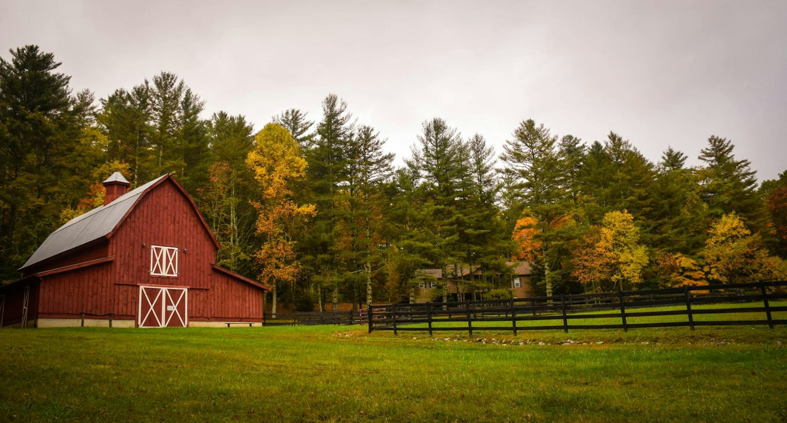
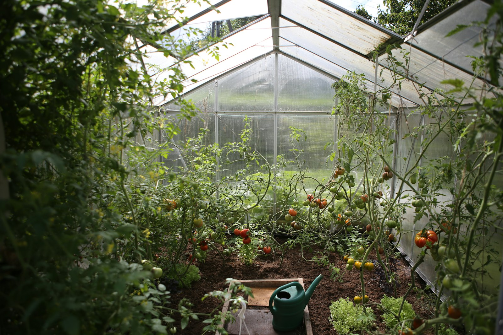
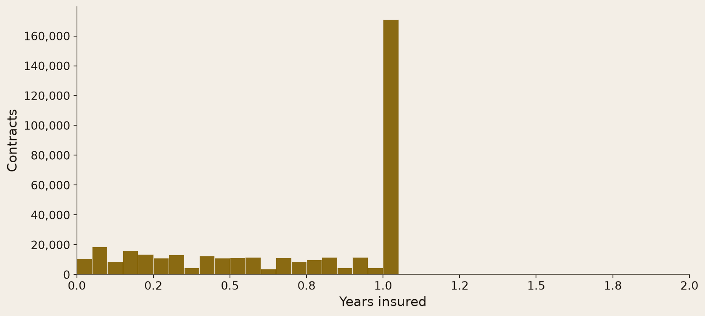
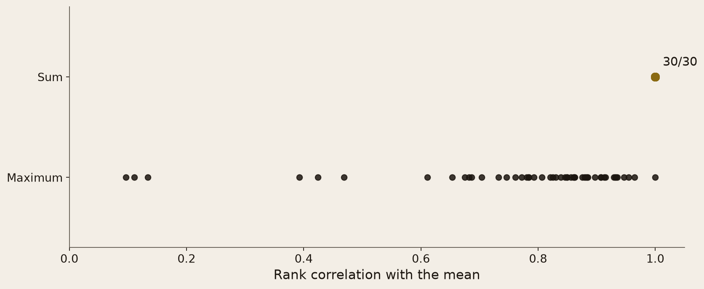
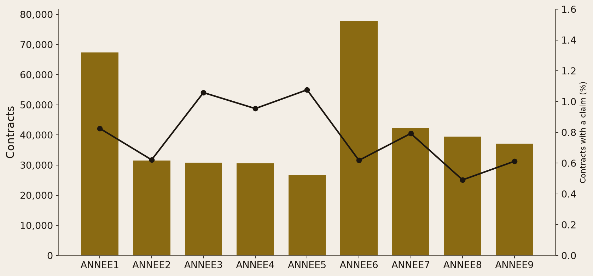
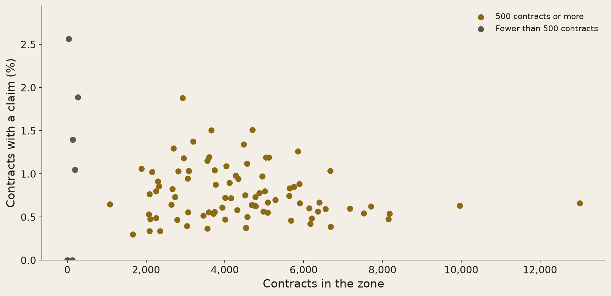
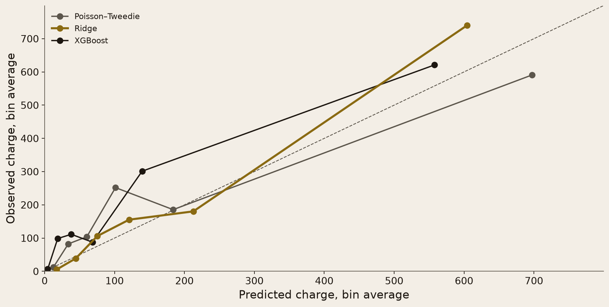

<!-- _class: cover -->
<!-- _paginate: false -->

# Where is the signal
# when 99% of the rows
# are zero?

Machine learning · Agriculture · Python / scikit-learn / XGBoost / Flask

France · 9 anonymised exercise years · 1 row = 1 contract × 1 exercise year

---

<!-- _class: split -->

# Predicting zero everywhere
# already scores RMSE 6,803.

99.25% of the 383,610 rows have `FREQ` = 0. Fire is still the main slice of the multi-risk claims cost.

**The floor is high because the mass is zero.**

---

<!-- _class: split -->

# Pacifica turns that
# into a pure premium.

Poisson frequency, Tweedie severity, log link. The score is on `CHARGE`, after the two pieces are combined.

**The decision is the expected fire cost on the contract-year.**

---

<!-- _class: full -->

# Claim cost equals frequency
# times severity times exposure.

A fire in a farm building is rare. Working hypothesis: the signal is which contract has a claim, more than which year label it sits in.

---

<!-- _class: split -->

# Features and targets
# join on `ID`.

383,610 × 374 in. Targets live apart: `FREQ`, `CM`, `ANNEE_ASSURANCE`, `CHARGE`. The test file has the same columns and no targets.

**A claim count and an amount in euros do not belong in the same model.**

---

<!-- _class: split -->

# Exposure sits inside
# the definition.

`ANNEE_ASSURANCE` runs from 0.003 to 2 years. Median 0.88. It enters `CHARGE` by formula. Both files carry the same values.

**A copied column inflates a model and adds no fact.**

---

<!-- _class: dark -->

# Scope.

We estimate the fire pure premium.

The commercial tariff, prevention, and the other covers on the policy stay out.

---

<!-- _class: chart -->

## Exposure often stops short of a year.

54.7% under one year. 44.6% exactly at 1. 0.7% between 1 and 2.

---

<!-- _class: full -->

# 2,894 contracts
# have at least one claim.

Out of 383,610. 536 of those claims have a zero cost. Six average costs are negative.

---

<!-- _class: chart -->

## The weather sum repeats the mean's rank.

Thirty indicators out of thirty. The maximum moves with the mean, and is not the same column.

---

<!-- _class: split -->

# Two columns,
# one measurement.

`SURFACE1` and `SURFACE2` differ on 5 contracts. `SURFACE4` and `SURFACE6` match wherever both are filled.

**`KAPITAL10` copies `KAPITAL11`, and is 0 where `KAPITAL11` is blank. `KAPITAL1` only flags `KAPITAL13`.**

---

<!-- _class: chart -->

## Headcount runs from 27,000 to 78,000.

The claim rate roughly doubles, and stays near 1%.

---

<!-- _class: chart -->

## Past 1,000 contracts, the rate spans a factor of six.

93 zones. Grey means fewer than 500 contracts. Three zones have fewer than 100.

---

<!-- _class: full -->

# Ridge beats
# the floor.

RMSE **7,039.79** on 76,722 contracts. XGBoost 7,041.55. Predict 0: 7,045.28. Poisson–Tweedie: 7,047.10.

---

<!-- _class: chart -->

## Ridge orders contracts, from the quiet ones to a fire.

Six equal groups. Mean observed charge: 6 in the lowest, 740 in the highest. The dashed line is perfect agreement.

---

<!-- _class: dark -->

# The deepest tree
# loses the tuning.

Eight settings. Depth 6 was the worst on the inner split.

**That split preferred the trees. The hold-out keeps Ridge.**

---

<!-- _class: dark -->

# Where it breaks.

The gain over “predict 0” is 5.5 RMSE points. The top sixth is still under-predicted.

The year labels have no date. There is no client id.

Station weather is missing on about 57% of rows.

---

<!-- _class: cta -->

# Reproduce.

`pytest`

`python scripts/select_models.py`

`python train.py`

[Code](https://github.com/dimiphoton/ML-zoom-camp-midterm-project)

