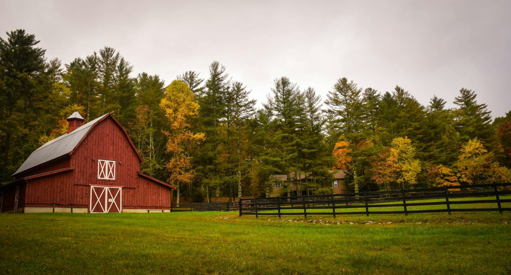
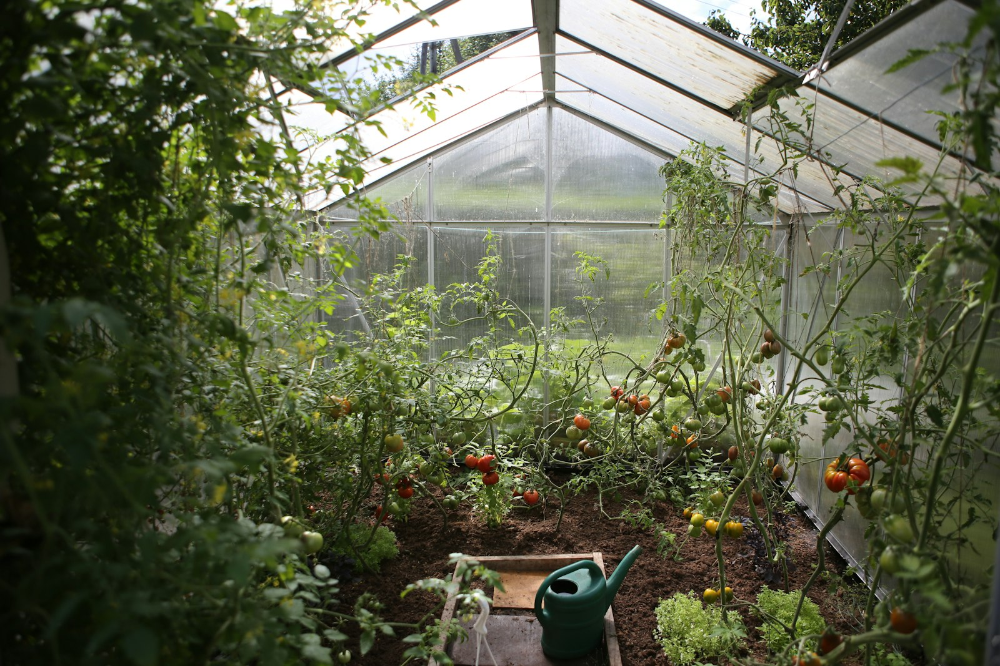
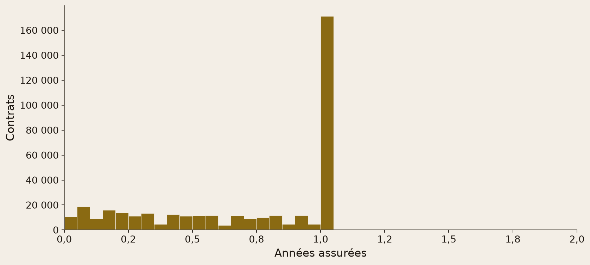
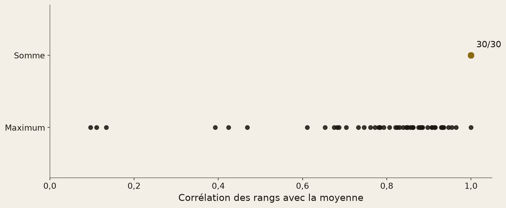
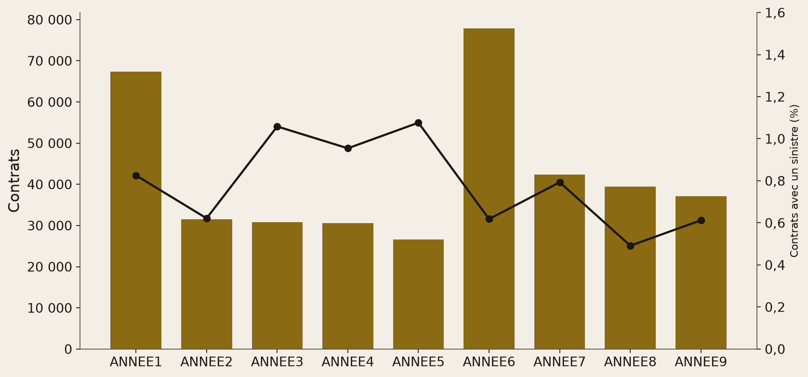
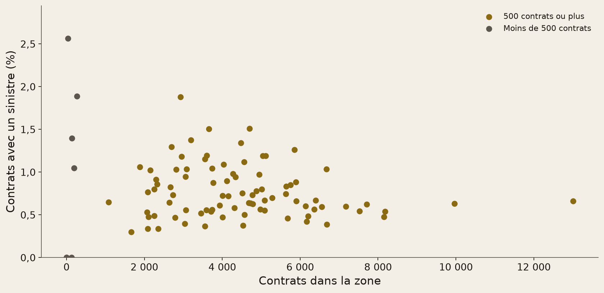
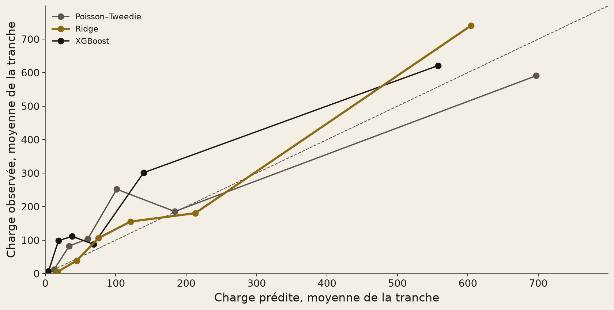

<!-- _class: cover -->
<!-- _paginate: false -->

# Où est le signal
# quand 99 % des lignes
# valent zéro ?

Machine learning · Agriculture · Python / scikit-learn / XGBoost / Flask

France · 9 exercices anonymisés · 1 ligne = 1 contrat × 1 exercice

---

<!-- _class: split -->

# Prédire zéro partout
# fait déjà 6 803 de RMSE.

99,25 % des 383 610 lignes ont `FREQ` = 0. L'incendie reste la part majeure de la charge du multirisque.

**Le plancher est haut parce que la masse est nulle.**

---

<!-- _class: split -->

# Pacifica en fait
# une prime pure.

Fréquence Poisson, coût moyen Tweedie, lien log. Le score porte sur `CHARGE`, une fois les deux morceaux réunis.

**La décision : le coût d'incendie attendu sur le contrat-exercice.**

---

<!-- _class: full -->

# Charge = fréquence
# × coût × exposition.

Le feu sur un bâtiment d'exploitation est rare. Hypothèse : le signal est dans qui a un sinistre, plus que dans le millésime.

---

<!-- _class: split -->

# Variables et cibles
# se joignent par `ID`.

383 610 × 374 en entrée. Cibles à part : `FREQ`, `CM`, `ANNEE_ASSURANCE`, `CHARGE`. Le test a les mêmes colonnes, sans cibles.

**On ne met pas un nombre de sinistres et un montant en euros dans le même modèle.**

---

<!-- _class: split -->

# L'exposition est dans
# la définition.

`ANNEE_ASSURANCE` va de 0,003 à 2 ans. Médiane 0,88. Elle entre dans `CHARGE` par formule. Les deux fichiers la portent à l'identique.

**Une colonne recopiée gonfle le modèle sans ajouter un fait.**

---

<!-- _class: dark -->

# Périmètre.

On estime la prime pure incendie.

On laisse le tarif commercial, la prévention, et les autres garanties du contrat.

---

<!-- _class: chart -->

## L'exposition s'arrête souvent avant un an.

54,7 % sous un an. 44,6 % exactement à 1. 0,7 % entre 1 et 2.

---

<!-- _class: full -->

# 2 894 contrats
# ont au moins un sinistre.

Sur 383 610. 536 de ces sinistres ont un coût nul. Six coûts moyens sont négatifs.

---

<!-- _class: chart -->

## La somme météo a le même rang que la moyenne.

Trente grandeurs sur trente. Le maximum suit, sans être la même colonne.

---

<!-- _class: split -->

# Deux colonnes,
# une seule mesure.

`SURFACE1` et `SURFACE2` diffèrent sur 5 contrats. `SURFACE4` et `SURFACE6` coïncident dès que les deux sont remplies.

**`KAPITAL10` recopie `KAPITAL11`, et vaut 0 là où `KAPITAL11` est vide. `KAPITAL1` ne fait que signaler `KAPITAL13`.**

---

<!-- _class: chart -->

## L'effectif passe de 27 000 à 78 000.

Le taux de sinistre va du simple au double, et reste autour de 1 %.

---

<!-- _class: chart -->

## Au-delà de 1 000 contrats, le taux varie d'un facteur six.

93 zones. En gris, moins de 500 contrats. Trois zones en ont moins de 100.

---

<!-- _class: full -->

# Ridge passe
# sous le plancher.

RMSE **7 039,79** sur 76 722 contrats. XGBoost 7 041,55. Prédire 0 : 7 045,28. Poisson–Tweedie : 7 047,10.

---

<!-- _class: chart -->

## Ridge range les contrats, du calme vers le sinistre.

Six parts égales. Charge observée moyenne : 6 en bas, 740 en haut. Le pointillé est l'accord parfait.

---

<!-- _class: dark -->

# L'arbre le plus profond
# n'est pas le bon.

Huit réglages. Profondeur 6 : le pire sur la découpe interne.

**Cette découpe préférait les arbres. Le hold-out départage, et il retient Ridge.**

---

<!-- _class: dark -->

# Où ça casse.

Le gain sur « prédire 0 » est de 5,5 points de RMSE. Le sixième le plus haut reste sous-estimé.

Les millésimes n'ont pas de date. Pas d'identifiant client.

La météo de station manque sur environ 57 % des lignes.

---

<!-- _class: cta -->

# Reproduire.

`pytest`

`python scripts/select_models.py`

`python train.py`

[Code](https://github.com/dimiphoton/ML-zoom-camp-midterm-project)

